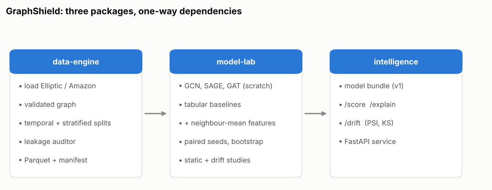
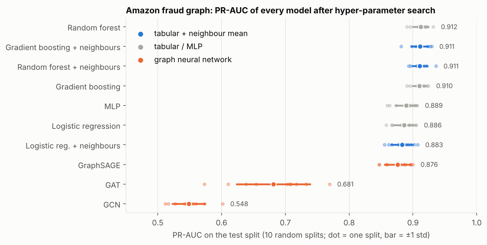
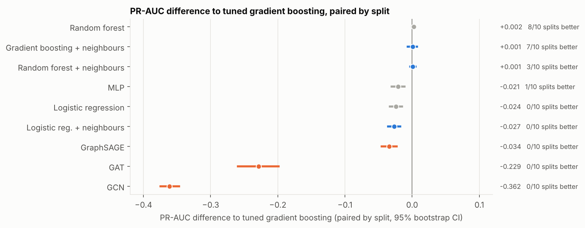
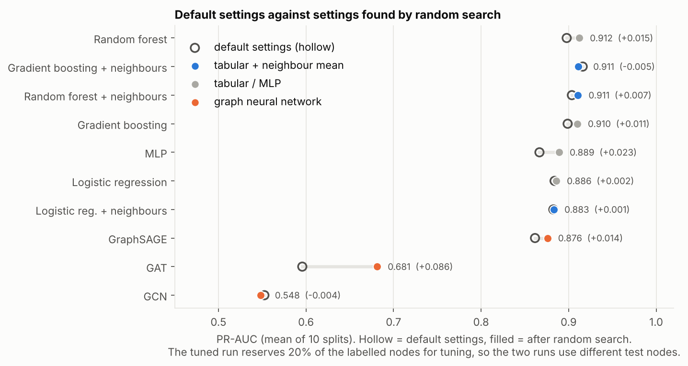
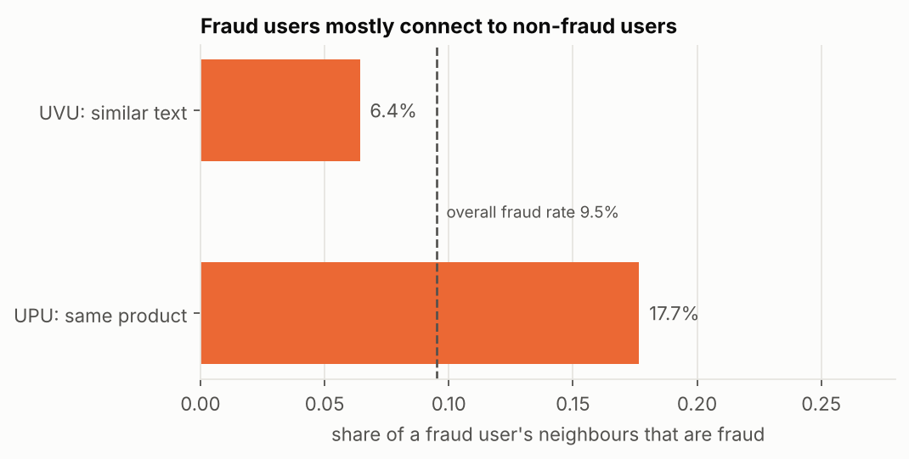

# GraphShield

Research engineering project on **temporal robustness of graph neural networks for
illicit-transaction detection**. It is organised as three independently installable packages
with one-way dependencies:

```
graphshield-data-engine  ──▶  graphshield-model-lab  ──▶  graphshield-intelligence
 datasets, splits, audit       GNN layers, baselines,        scoring / explanation /
 (numpy, pandas, pyarrow)      metrics, protocol (torch)     drift service (FastAPI)
```

| Package | Responsibility | Contract it publishes |
|---|---|---|
| [`graphshield-data-engine`](graphshield-data-engine) | load, validate, store and split temporal graphs; audit splits for leakage | Parquet + `manifest.json` (schema v1) |
| [`graphshield-model-lab`](graphshield-model-lab) | from-scratch GCN/GraphSAGE/GAT, tabular baselines, metrics, multi-seed protocol | model bundle (format v1) |
| [`graphshield-intelligence`](graphshield-intelligence) | HTTP scoring, saliency explanations, PSI/KS drift reports | REST API |

Each package has its own `pyproject.toml`, tests and README.



## Research question

On the Elliptic Bitcoin transaction graph, published GNN results are hard to compare because
splits, seeds and leakage controls differ. Under a strict, audited temporal protocol:

1. Is the GNN-versus-gradient-boosting gap real, or explained by neighbourhood-averaged
   features and evaluation choices?
2. Which drift mitigations (rolling retraining windows, feature pruning) help after the
   dark-market shutdown, when all models are known to degrade?
3. How do models compare on analyst-facing metrics (precision@k, calibration), not just F1?

The intended contribution is a leak-audited, multi-seed benchmark with ablations, not a new
architecture.

## Status (honest summary)

| Item | State |
|---|---|
| Data engine, GNN layers, baselines, metrics, protocol, service | implemented; unit tests pass |
| Layers verified against dense reference computations | yes |
| Cross-check against PyTorch Geometric | GCN, GraphSAGE and GAT layers match `torch_geometric` outputs to 1e-5 (tests run when PyG is installed; verified in development) |
| Experiments on the real Elliptic dataset (temporal) | **not run**: the download was unreachable from the development container |
| Experiments on a real fraud graph (Amazon, static) | **run**: 10 seeds, defaults and an equal-budget random search with a leak-free tuning pool; see Results on real data |
| Static-vs-rolling drift study (`graphshield-lab drift`) | implemented; tested on synthetic graphs with a built-in concept shift (rolling retraining wins there, as expected, which only shows the code works) |
| Hyperparameter search, ablations, statistical comparison tables on real data | **not run**; `scripts/run_elliptic.sh` reproduces the planned runs once the data is available |
| Docker image | Dockerfile written, never built |

No benchmark numbers appear in this repository because none have been measured on real data.
Smoke runs on synthetic graphs only verify that the code executes. The Elliptic download was
not reachable from the development container (Kaggle and the PyG mirror were blocked), and
the container has no GPU.

## Results on real data

### Amazon fraud graph (static, no timestamps)

Real user-review fraud graph: 11,944 users, 25 handcrafted features, user–product–user (UPU)
relation with 351,216 directed edges. The first 3,305 nodes carry placeholder labels and are
treated as unlabelled, leaving 8,639 labelled users (9.5% fraud). Full tables and per-seed
values: [`graphshield-model-lab/results/amazon/`](graphshield-model-lab/results/amazon).

**Protocol.** Each of 10 seeds draws a fresh stratified 40/20/40 train/validation/test split
and every model is trained and tested on that same split (paired by seed). Training is
transductive (the whole graph is visible, only training labels are used). Two runs:

1. **Default settings** for every model (fixed GNN hyper-parameters: 2 layers, 64 hidden
   units, 100 epochs).
2. **Tuned**: an identical random-search budget (8 trials) for every model family, tabular and
   graph. The search uses a *reserved tuning pool* of 20% of the labelled nodes whose labels are
   hidden from the evaluation splits, so no node used to choose hyper-parameters is ever a
   test node. This run therefore evaluates on 6,911 labelled nodes.



Tuned run, mean ± std over 10 splits:

| model | PR-AUC | ROC-AUC | F1 | P@100 |
|---|---|---|---|---|
| logistic regression | 0.886 ± 0.016 | 0.969 ± 0.004 | 0.839 ± 0.009 | 0.971 ± 0.012 |
| random forest | **0.912 ± 0.012** | 0.979 ± 0.004 | 0.850 ± 0.022 | 0.980 ± 0.011 |
| gradient boosting | 0.910 ± 0.010 | 0.980 ± 0.003 | 0.859 ± 0.016 | 0.982 ± 0.010 |
| random forest + neighbour-mean features | 0.911 ± 0.012 | 0.977 ± 0.005 | 0.852 ± 0.022 | 0.982 ± 0.013 |
| gradient boosting + neighbour-mean features | 0.911 ± 0.013 | 0.979 ± 0.004 | 0.859 ± 0.014 | 0.976 ± 0.017 |
| MLP | 0.889 ± 0.016 | 0.972 ± 0.003 | 0.845 ± 0.008 | 0.969 ± 0.014 |
| GraphSAGE | 0.876 ± 0.020 | 0.966 ± 0.005 | 0.824 ± 0.016 | 0.969 ± 0.014 |
| GAT | 0.681 ± 0.057 | 0.905 ± 0.019 | 0.659 ± 0.052 | 0.844 ± 0.048 |
| GCN | 0.548 ± 0.025 | 0.877 ± 0.013 | 0.510 ± 0.017 | 0.744 ± 0.033 |



Paired differences to tuned gradient boosting (PR-AUC, bootstrap 95% CI over the 10 splits):
adding neighbour-mean features **+0.001** [−0.007, +0.007] (7/10 splits better, i.e. no measurable
gain); random forest +0.002 [−0.000, +0.005]; GraphSAGE −0.034 [−0.045, −0.023] (0/10); MLP
−0.021; GAT −0.229; GCN −0.362 (0/10).

**The conclusion changed with tuning, and that is the main lesson.** With default settings,
gradient boosting + neighbour features beat plain gradient boosting by +0.017 [+0.013, +0.021]
(10/10 splits) and looked like evidence that graph structure helps. After giving every model the
same search budget, plain gradient boosting rises to 0.910 and the gap disappears. The search
changed PR-AUC by −0.005 to +0.023 for every model except GAT (+0.086; part of that gap may
be the different evaluation nodes), and GCN stayed at 0.55.



**What this supports.** On this graph, tuned tree ensembles (0.91) are at least as good as every
GNN tested; GraphSAGE (0.876) is roughly on par with an MLP (0.889) and logistic regression
(0.886); GCN and GAT are far behind. Fraud users mostly connect to non-fraud users, which fits
GCN/GAT mixing a node with its neighbours: only 17.7% of a fraud node's UPU neighbours are fraud
(base rate 9.5%) and edge homophily is 0.785, below the 0.828 expected under random wiring.
GraphSAGE keeps a separate self term and does much better. That explanation is consistent with
the measurements but was not tested by an intervention.



**Caveats.** One graph and one relation (the denser UVU relation, run with default settings on 3
seeds, gives the same ordering: `results/amazon/static_uvu.json`). Random, non-temporal splits
with transductive training. The tuned and default runs use different amounts of labelled data
(20% reserved for tuning), so their numbers are not directly comparable. Eight random-search
trials per family is a modest budget; GNNs might gain more from a larger search. This graph says
nothing about temporal drift; the Elliptic study below is still pending.

## Quick start

```bash
pip install -e graphshield-data-engine -e graphshield-model-lab -e graphshield-intelligence
graphshield-data synth --out /tmp/synth --steps 30 --shift-step 22   # synthetic, tests only
graphshield-lab run --data /tmp/synth --train-end 15 --val-end 20 --models logreg gcn sage gat
```

For the real dataset, download Elliptic from its official source (check the license), then
`graphshield-data convert --raw <dir> --out data/elliptic`.

## Development

```bash
pip install -e "graphshield-data-engine[dev]" -e "graphshield-model-lab[dev]" -e "graphshield-intelligence[dev]"
for d in graphshield-*; do (cd $d && pytest -q); done
```

CI (`.github/workflows/ci.yml`) installs the three packages together and runs lint and tests.

## Regenerating the figures

Every figure in `docs/figures/` is produced from the result files by a script (no number is
typed by hand). `pip install matplotlib`, then:

```bash
python scripts/amazon_homophily.py /path/to/Amazon.mat graphshield-model-lab/results/amazon/homophily.json
python scripts/make_figures.py
```

## License

MIT. Third-party datasets keep their own licenses.
