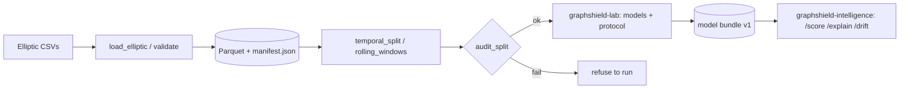

# GraphShield: methodology and paper outline

## Architecture

## Data

Elliptic Bitcoin dataset: transactions as nodes, payment flows as edges, 49 time steps, 166
features, labels licit / illicit / unknown. Edges connect transactions within the same time
step. Obtain it from its official source and check its license; it is not redistributed here.

## Protocol (identical for every model)

1. Train/validation/test are contiguous time ranges (train < validation < test), built from
   *labelled* nodes only, and checked by `audit_split` (overlap, ordering, empty classes,
   train↔evaluation edges, duplicated feature rows). The harness refuses to run on a split
   that fails.
2. Training sees only the subgraph of nodes up to the last training step.
3. Features are standardised with training-split statistics.
4. Early stopping (validation PR-AUC) and the F1 decision threshold use validation data only.
5. Test metrics are computed once with those choices fixed; results are reported as mean ±
   std over seeds, with bootstrap intervals and paired bootstrap tests between models.

## Static-graph protocol (Amazon fraud graph)

Without timestamps there is no temporal split. Each seed draws a stratified 40/20/40
train/validation/test split of the labelled nodes (a fresh split per seed), every model is
trained and evaluated on that same split, and models are compared *paired by seed*.
Training is transductive (the whole graph and all features are visible, only training labels
are used). The first 3,305 nodes carry placeholder labels and are treated as unknown.

## Models

Logistic regression, random forest, histogram gradient boosting, each also with one-hop mean
neighbour features (`+agg`); an MLP; GCN, GraphSAGE (mean) and GAT implemented directly on
edge lists with scatter operations and verified against dense-matrix references (and
against PyTorch Geometric when it is installed).

## Metrics

PR-AUC (primary, because illicit nodes are rare), ROC-AUC, F1 and MCC at the validation
threshold, precision@k (analyst alert budget), expected calibration error, per-time-step F1
for drift curves.

## Threats to validity

- Elliptic is one network over a short period; conclusions may not transfer.
- Labels are partly heuristic; "unknown" nodes are excluded from evaluation but remain in the
  message-passing graph.
- Hyper-parameter budgets differ between tabular and graph models unless matched explicitly.
- Bootstrap tests resample nodes and ignore seed variance; report both.

## Paper outline (results to be filled in only from `results/*.json`)

1. Introduction: reported GNN-versus-tree results on Elliptic are hard to compare.
2. Related work: Elliptic benchmark paper, GCN/GAT/GraphSAGE, temporal GNNs, drift.
3. Protocol: audited temporal splits, leakage controls.
4. Experiments: baselines vs. GNNs; neighbour-feature ablation; depth and direction
   ablations; rolling-window retraining after the time-step-43 shift; calibration and
   precision@k.
5. Error analysis and explainability (saliency).
6. Limitations and conclusion.
